# Ensemble · 智能体团队 for Paseo

**[English](#english)** · **[中文](#中文)**


---

## English

Ensemble is a [Paseo](https://paseo.sh) plugin that gives a project a team of coding agents. You talk to one **lead** agent (the orchestrator). Each **member** runs as its own Paseo agent on its own provider and model, for example Claude for the backend, Codex for review and Gemini for docs. The lead works in one of these collaboration modes, or picks one for each request:

| Mode | Pattern | How a request runs |
| --- | --- | --- |
| **Team** | MA-08, shared board | First, intake with you: the lead restates the request, asks questions, and records a brief and a task plan. Nothing starts until you confirm the brief. Then the members work from a shared task board: dependencies, atomic claims, ready tasks handed to idle members, a mailbox on the team board, file claims and optional plan approval. A review round follows, in which members check each other's done tasks. |
| **Delegation** | MA-04, orchestrator–workers | The lead splits the request into self-contained packets, one per role. Each member works alone in its own context and reports only to the lead, who sums up. |
| **Auto** | | The lead picks team or delegation for each request. The first run fixes the session to that mode. |
| **None** | | No members: the lead works alone. |

The team is a file in the repository (`.agents/teams/<workspace>.json`), so it is shared through git. The lead and members coordinate only through the plugin's own agent tools (`team_delegate`, `team_brief`, `team_kickoff`, `team_task`, `team_board_post`, …). Because of that, every member runs on exactly its role's provider and model, and the plugin moves the run along: rounds, reviews, waking members that were asked a question, and telling an idle lead that its run has finished.

Everything the team does is recorded as a **data flow**: who wrote into which part of the mode, and what each part handed to whom. In team mode the parts are the brief, task board, plan approval, team board and file claims; in delegation mode they are the split, sub-agent contexts, reports and summary. The session dashboard shows it live.

### Screenshots

The **team editor** is a page of sections with a live check. Its header shows **Valid** or the number of problems; press it to list them, and press a problem to go to its field. **Save** writes the team file, and **Start a session** writes it and starts the lead.

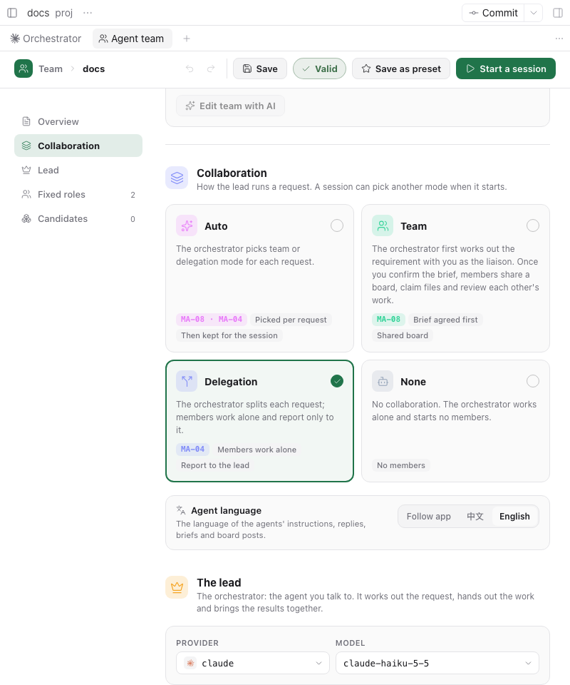

The **Agent team sidebar** sits next to Files and Changes. **Session** shows the workspace's lead, a mode switch, the members and the run's data flow. **Start** starts a lead from this workspace's team or from a preset, and **Teams** lists the project's teams and the presets. The **session dashboard** shows one run in full:

<p>
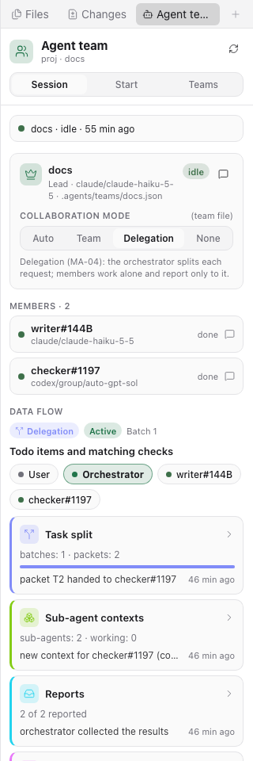
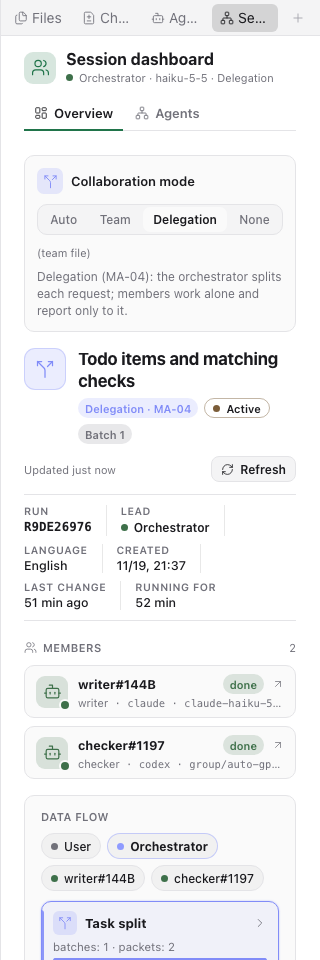
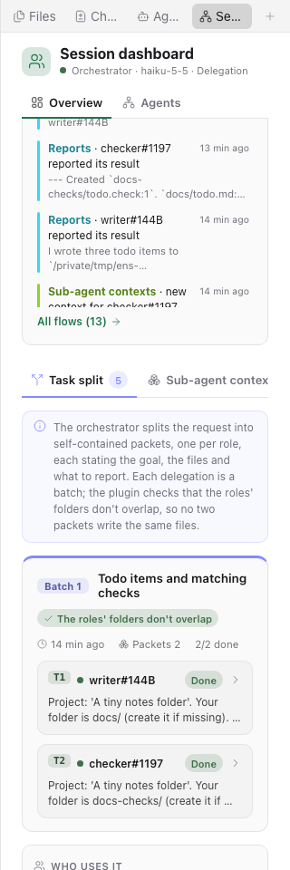
</p>

When the lead hands work to a member, its chat shows a **Handed off to agent** card, and an **Update from worker** card when the member reports. Press a card to read the task or the result; press the member's name to open its chat:

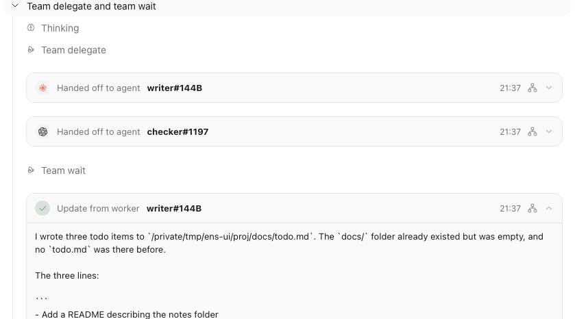

The **Agent teams** screen holds the global presets (rename, copy into a project, edit, delete) and every project's teams:

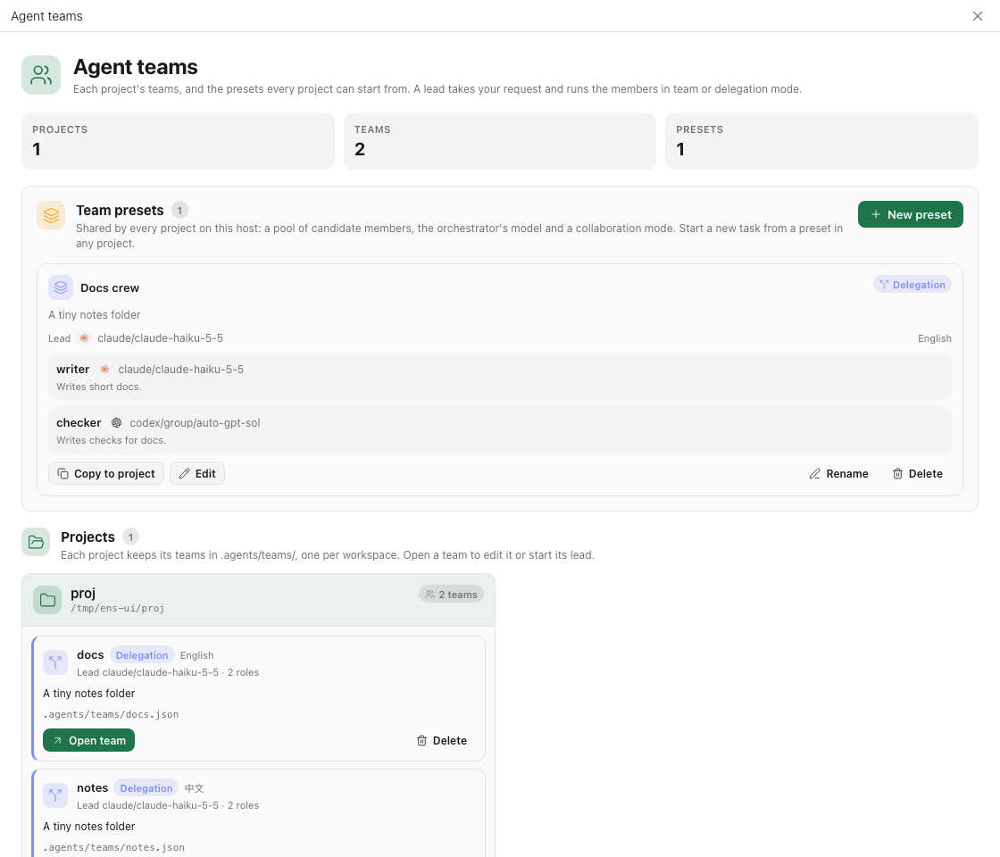

### Start a team from Paseo's own new chat

In a new agent's draft, or on the New workspace screen, the composer has a **Team** control next to the model picker: no team, this workspace's team, or any of your presets. Pick one, type the request and send: that agent becomes the team's lead and starts on your request. A preset also picks its lead model, and is written as the workspace's team file; a **Team mode** control next to it sets the mode for the session.

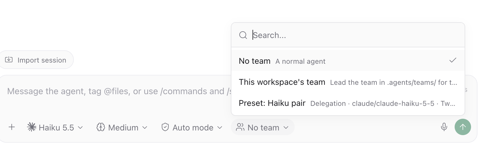

Workspaces that run a team get a badge in the sidebar with their mode, or how many members are working or need you.

### What you get in Paseo

- **Team editor** (the **Agent team** tab of a workspace): describe a goal, or leave it empty and let a planner read the project. The planner proposes roles, candidate members and a mode as a draft. The editor has a section for each part of the team: the overview, the collaboration mode, the lead, fixed roles and candidates. It also has searchable provider and model pickers, folders, instructions, **Edit with AI** with undo and redo, and a live check. **Save** writes the team file. **Start a session** writes it and starts the lead, with an optional first request, a mode and a language for that session, in this workspace or a new one. **Save as preset**, **Apply again** and **Reset session** are here too.
- **Agent team sidebar** (the right sidebar's **+** menu, or **Open the Ensemble side panel** in the Command Center): **Session** has the workspace's lead with its mode switch, the members (open their chat) and the run's data flow (each part opens the session dashboard). **Start** starts a lead from this workspace's team or a preset. **Teams** lists the project's teams and presets.
- **Delegation cards**: the lead's chat shows **Handed off to agent** when a member is given work and **Update from worker** when it reports (marked Failed or Stopped when its turn did not complete). The cards open the member's chat and the session dashboard.
- **Members work unattended**: each member starts in its provider's full-access mode (`bypassPermissions` for Claude, `full-access` for Codex, …), and the plugin allows any tool permission prompt a member still raises, so delegated work never waits for you to click Allow. The lead keeps its reviewed auto mode.
- **Session dashboard**: open it from the lead's **Dashboard** pill, the Command Center or `/dashboard`. It shows one conversation only, with tabs:
  - **Overview**: the mode switch (it shows a lock 🔒 once Auto has chosen), the run's header and details, the members and the data flow with the latest flows.
  - **Agents**: the agent tree, with three densities, closed agents and sub-agents.
  - **One page per part of the mode**: in team mode the brief, Kanban task board, plan approval, chat-style team board and file claims; in delegation mode the task split, sub-agent contexts, reports and summary.
  - **Data flow**: every step of the run.
- **Agent dashboard**: every session of the workspace, as trees.
- **Agent teams** screen (sidebar): every project's teams (open, reconnect, delete), and the **team presets**: rename one, copy it into a project as a team file, edit or delete it. **New task from preset** writes the team for a new or free workspace and starts the lead with your request.
- **Candidate members**: a pool of models described by what each is good at and must not do. The lead assigns work by those descriptions and never uses a model outside the pool.
- **Language**: the UI follows Paseo's language (English, 한국어, 日本語, 简体中文). Set a team's agent language to Chinese or English to choose the prompts, the tool texts and the language of the agents' replies.

### Requirements

- Paseo **0.16.0** or later, with **Settings → Plugins → Enable plugins** on.
- **Paseo tools for agents** on: Settings → your host → **Orchestration → Enable Paseo tools** (`daemon.mcp.injectIntoAgents`, off by default). The team tools are served next to Paseo's own tools. While this setting is off, the team editor warns you, and Start a session, Apply again and Reset session refuse to run.
- At least one ready provider (`paseo provider ls`).

### Install

```bash
paseo plugin add git:DueGin/paseo-ensemble
```

Or from a checkout:

```bash
git clone https://github.com/DueGin/paseo-ensemble.git
cd paseo-ensemble && npm install
paseo plugin install "$(pwd)"
paseo plugin ls      # paseo-ensemble should be "running"
```

Reload the Paseo window afterwards so the app picks up the plugin's UI.

**If `paseo-agent-team` is installed:** remove it with `paseo plugin remove paseo-agent-team` after installing Ensemble. Team files in `.agents/teams/` keep working, and presets saved by it can be imported once on the Agent teams screen.

### Team file

```json
{
  "version": 1,
  "goal": "Ship features in the web app end to end",
  "mode": "auto",
  "language": "en",
  "orchestrator": { "workspace": "web", "provider": "claude", "model": "claude-opus-5-5" },
  "roles": [
    { "name": "frontend", "provider": "claude", "model": "claude-sonnet-5-5", "folders": ["web/src"], "instructions": "Builds the React UI." },
    { "name": "backend", "provider": "codex", "model": "gpt-6.1-sol", "folders": ["api"], "instructions": "Owns the HTTP API." }
  ],
  "candidates": [
    { "provider": "claude", "model": "claude-haiku-5-5", "notes": "Good at: small edits, docs, checks\nDo not give it: cross-cutting changes" }
  ]
}
```

A team file can have roles, candidates or both, but not neither. Every field is described in the [guide](docs/guide.md#team-definition-format).

### More

- [docs/guide.md](docs/guide.md): the full manual, covering creating and changing teams, team mode in detail, presets, candidates, dashboards, permissions and limitations.
- [OVERVIEW.md](OVERVIEW.md): a short behaviour reference.
- Versions: each release is a git tag `vX.Y.Z` (the version in `package.json`). Install one with `paseo plugin add git:DueGin/paseo-ensemble --ref v0.6.0`.
- Development: `npm run typecheck && npm test` (unit tests). `PASEO_E2E=1 npx vitest run tests/collab.e2e.test.ts` runs both modes with real agents on a daemon (`PASEO_URL` picks it; use a throwaway daemon with its own `--home`).

---

## 中文

Ensemble 是 [Paseo](https://paseo.sh) 的插件，为项目配一支编码智能体团队。你只和**协调器**对话；每个**成员**是一个独立的 Paseo agent，用自己的 provider 和模型，例如后端交给 Claude、评审交给 Codex、文档交给 Gemini。协调器用下面的协作模式工作，也可以每个需求单独选择：

| 模式 | 模式编号 | 过程 |
| --- | --- | --- |
| **团队** | MA-08，共享黑板 | 先做需求对接：协调器复述需求、提问，记下需求简报和任务计划，你确认之前什么都不会启动。确认后，成员围绕共享任务板工作：任务依赖、原子认领、就绪任务派给空闲成员，团队黑板上互相留言，认领要改的文件，还可以开启计划审批。最后一轮成员互相评审已完成的任务。 |
| **委派** | MA-04，编排者-执行者 | 协调器把需求拆成独立的任务包，每个角色一个；成员各自在自己的上下文里完成，只向协调器汇报，协调器汇总。 |
| **自动** | | 每个需求由协调器选择团队或委派；第一次运行之后，整个会话固定为该模式。 |
| **无** | | 不启动成员，协调器独自完成。 |

团队定义是仓库里的一个文件（`.agents/teams/<工作区>.json`），通过 git 共享。协调器和成员只通过插件自己的 agent 工具协作（`team_delegate`、`team_brief`、`team_kickoff`、`team_task`、`team_board_post`……）。因此每个成员都严格运行在其角色的 provider 和模型上，运行也由插件推进：轮次、评审、唤醒被提问的成员、在运行结束时通知空闲的协调器。

团队的每一步都会记录成**数据流**：谁写入了模式的哪个组件，组件又交给了谁。团队模式的组件是需求简报、任务板、计划审批、团队黑板和文件认领；委派模式的组件是任务拆分、子智能体上下文、结果汇报和汇总。会话仪表盘会实时展示。

### 截图

**团队编辑器**按分区排布，并实时检查：顶部显示**有效**或问题数量，点开能看到问题列表，点某个问题就跳到对应字段。**保存**只写入团队文件，**开始会话**写入后启动协调器。

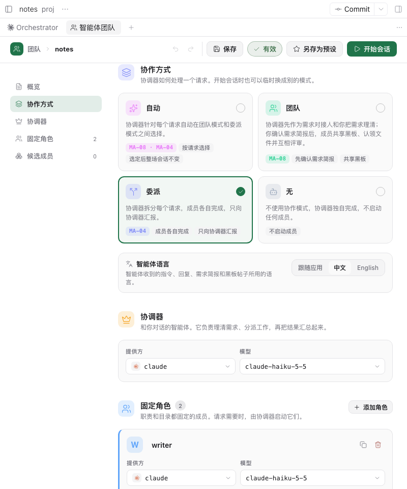

**智能体团队侧边栏**在「文件」「更改」旁边：**会话**页显示本工作区的协调器、模式切换、成员和本次运行的数据流；**开始**页用本工作区的团队或预设启动协调器；**团队**页列出项目里的团队和预设。**会话仪表盘**完整展示一次运行：

<p>
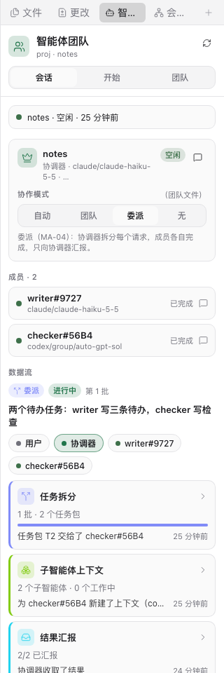
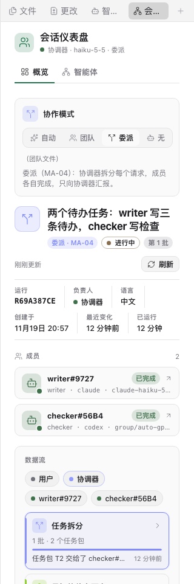
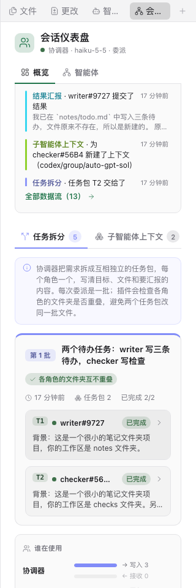
</p>

协调器把工作交给成员时，对话里会出现**已移交给智能体**卡片；成员汇报后出现**来自工作者的更新**卡片。展开卡片可以看任务或结果，点成员名字打开它的对话：

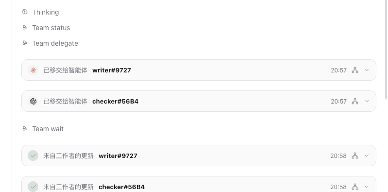

**智能体团队**页：全局预设（重命名、复制到项目、编辑、删除）和各项目的团队：

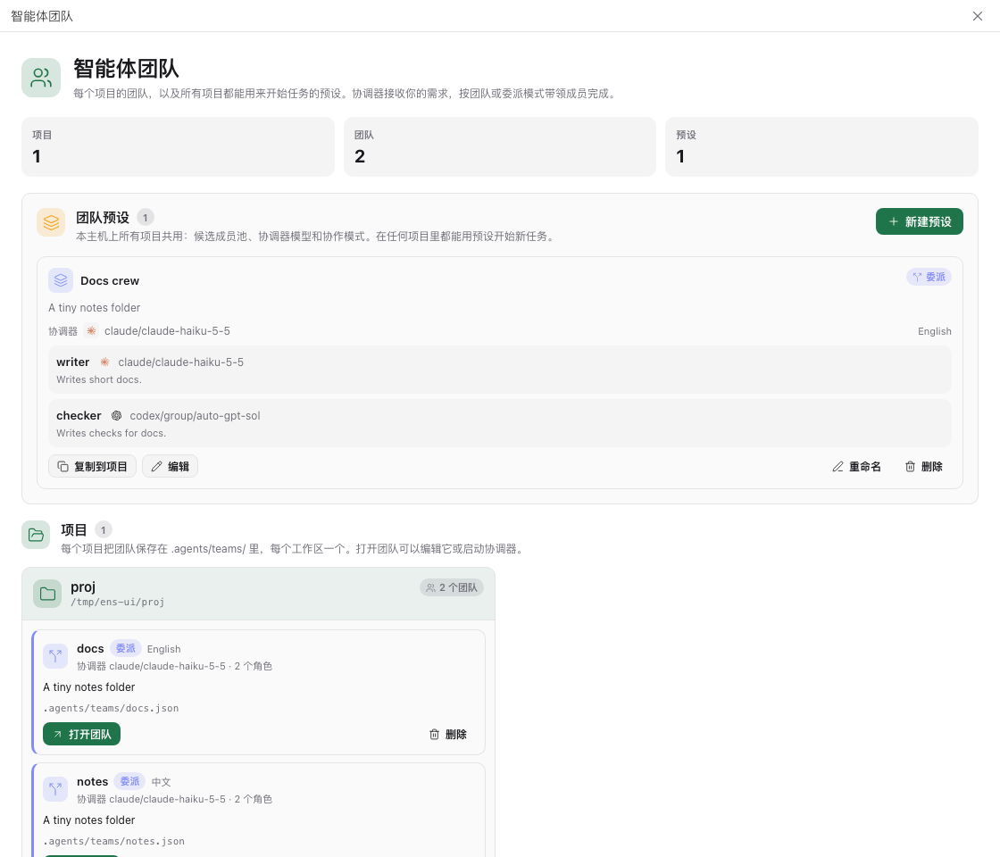

### 在 Paseo 自带的新会话里组队

新建 agent 的草稿里，以及「新建工作区」页面上，输入框的模型选择旁边多了一个**团队**控件：不使用团队、本工作区的团队，或你的任意预设。选好后写下需求发送，这个 agent 就成为团队的协调器并开始处理需求。选择预设时会同时切换到预设的协调器模型，并把预设写成该工作区的团队文件；旁边的**团队模式**控件可以为这段会话指定模式。

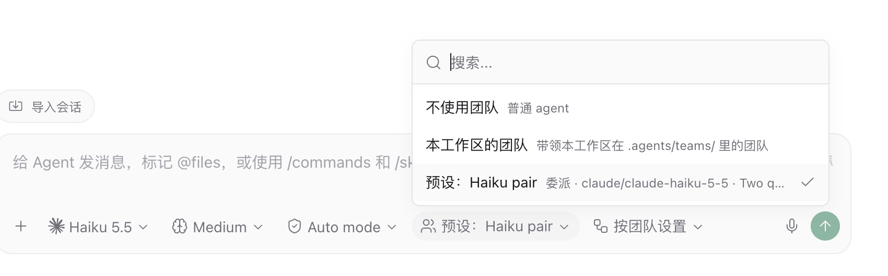

运行团队的工作区在侧边栏有一个徽标，显示协作模式，或几个成员在工作、几个需要你处理。

### 在 Paseo 里能用到的

- **团队编辑器**（工作区的「智能体团队」标签页）：写一个目标，或者留空让规划 agent 阅读项目，它会把角色、候选成员和协作模式作为草稿提出来。编辑器按团队的组成分区：概览、协作方式、协调器、固定角色、候选成员；provider 和模型可搜索选择，可设置目录和说明，可以**用 AI 编辑**并撤销重做，问题实时检查。**保存**写入团队文件；**开始会话**写入后启动协调器，可以附带第一条需求，并为这次会话选择模式和语言，在当前工作区或新工作区里运行。**另存为预设**、**重新应用**、**重置会话**也在这里。
- **智能体团队侧边栏**（右侧边栏的 **+** 菜单，或命令中心的「打开团队侧边栏」）：**会话**页有本工作区的协调器和模式切换、成员（可打开其对话）、本次运行的数据流（每个组件都能打开会话仪表盘）；**开始**页用本工作区的团队或预设启动协调器；**团队**页列出项目的团队和预设。
- **委派卡片**：成员接到工作时，协调器对话里出现「已移交给智能体」；成员汇报时出现「来自工作者的更新」（完成、失败或取消）。卡片可以打开成员的对话和会话仪表盘。
- **成员全权限运行**：每个成员都用其 provider 的完全访问模式启动（Claude 是 `bypassPermissions`，Codex 是 `full-access`……），成员仍然弹出的工具权限请求由插件自动允许，委派出去的工作不会停下来等你点「允许」。协调器仍用带审核的自动模式。
- **会话仪表盘**：从协调器的**仪表盘**按钮、命令中心或 `/dashboard` 打开。它只显示这一段会话，分为几个标签页：
  - **概览**：模式切换（自动模式确定后显示 🔒）、运行头部和信息、成员、数据流和最近的数据流。
  - **智能体**：智能体树，有三种密度，能显示已关闭的 agent 和子 agent。
  - **每个组件一页**：团队模式下是需求简报、看板式任务板、计划审批、对话式团队黑板、文件认领；委派模式下是任务拆分、子智能体上下文、结果汇报、汇总。
  - **数据流**：运行中的每一步。
- **智能体仪表盘**：以树的形式展示工作区里的所有会话。
- **智能体团队**页（侧边栏）：各项目的团队（打开、重新关联、删除），以及**团队预设**：可以重命名、复制到项目里成为团队文件、编辑或删除。**用预设开始新任务**会为新建或空闲的工作区写好团队，并把你的需求作为协调器的第一条消息启动它。
- **候选成员**：一组模型，每个写明擅长什么、不要交给它什么。协调器按描述分工，绝不使用池子以外的模型。
- **语言**：界面跟随 Paseo 的语言（English、한국어、日本語、简体中文）。团队的智能体语言可以设为中文或英文，决定提示词、工具文字和智能体回复所用的语言。

### 要求

- Paseo **0.16.0** 或更新，并打开 **设置 → 插件 → 启用插件**。
- 打开**给 agent 提供 Paseo 工具**：设置 → 你的主机 → **Orchestration → Enable Paseo tools**（`daemon.mcp.injectIntoAgents`，默认关闭）。团队工具和 Paseo 自带工具一起提供给 agent；这个设置关闭时，团队编辑器会提示，「开始会话」「重新应用」「重置会话」也会拒绝执行。
- 主机上至少有一个可用的 provider（`paseo provider ls`）。

### 安装

```bash
paseo plugin add git:DueGin/paseo-ensemble
```

或者从本地目录安装：

```bash
git clone https://github.com/DueGin/paseo-ensemble.git
cd paseo-ensemble && npm install
paseo plugin install "$(pwd)"
paseo plugin ls      # paseo-ensemble 应为 "running"
```

安装后重新加载 Paseo 窗口，让应用加载插件界面。

**如果装过 `paseo-agent-team`：** 装好 Ensemble 后用 `paseo plugin remove paseo-agent-team` 删除它。`.agents/teams/` 里的团队文件照常可用；它保存过的预设，可以在智能体团队页一键导入。

### 团队文件

格式见上方英文部分的 [Team file](#team-file)，所有字段的说明见[使用手册](docs/guide.md#team-definition-format)。固定角色和候选成员可以只有其一，但不能都为空；`language` 填 `zh`、`en`，或省略以跟随 Paseo 的语言。

### 更多

- [docs/guide.md](docs/guide.md)：完整使用手册（英文），包括创建和修改团队、团队模式细节、预设、候选成员、仪表盘、权限和限制。
- [OVERVIEW.md](OVERVIEW.md)：简短的行为说明。
- 版本：每个发布版本都有对应的 git tag `vX.Y.Z`（即 `package.json` 里的版本号）。安装指定版本：`paseo plugin add git:DueGin/paseo-ensemble --ref v0.6.0`。
- 开发：`npm run typecheck && npm test` 运行单元测试；`PASEO_E2E=1 npx vitest run tests/collab.e2e.test.ts` 用真实 agent 在 daemon 上把两种模式各跑一遍（用 `PASEO_URL` 指定 daemon；请用带独立 `--home` 的临时 daemon）。

## License

MIT. See [LICENSE](LICENSE).
