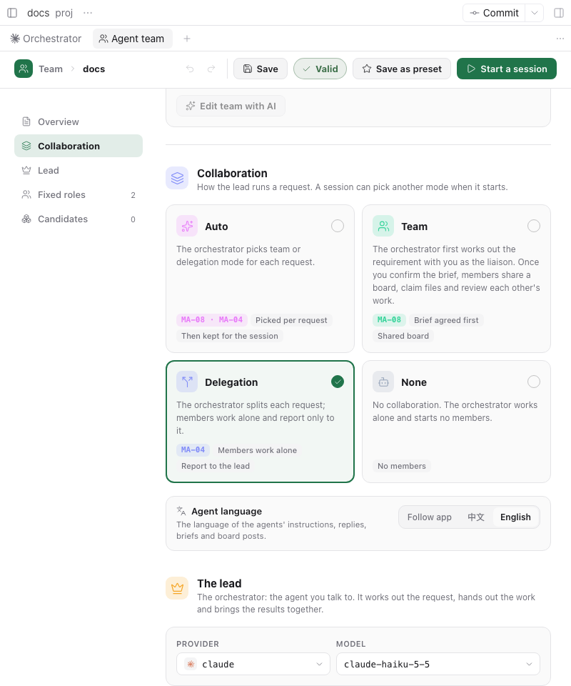
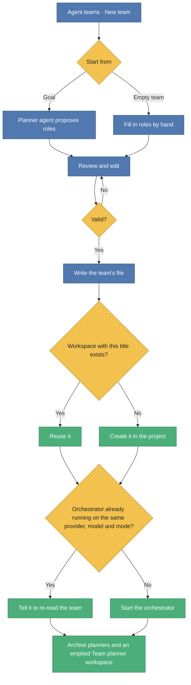
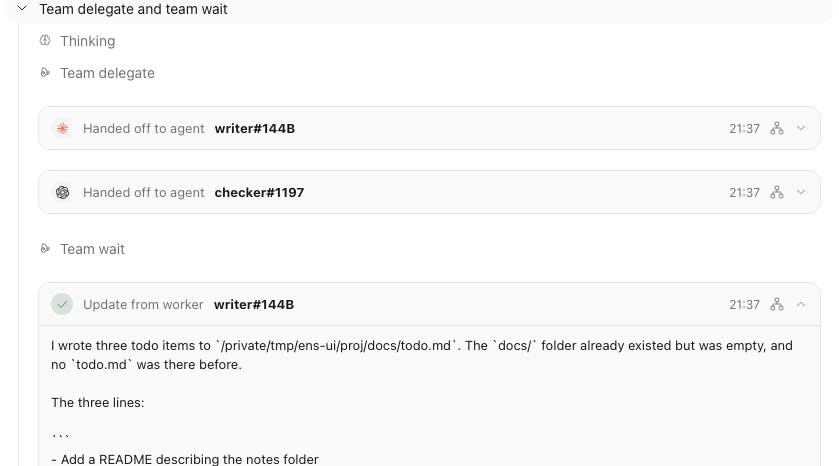
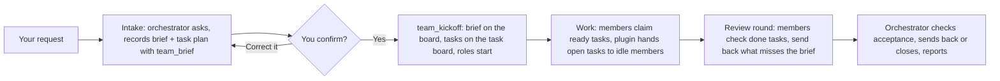
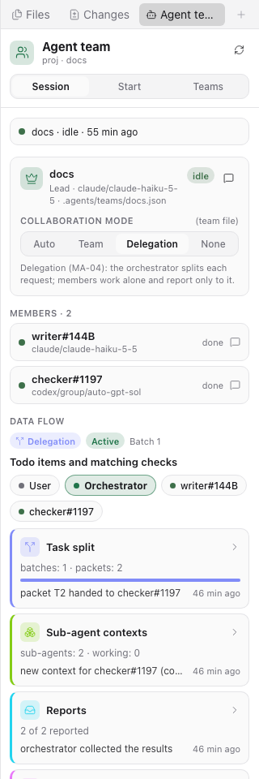
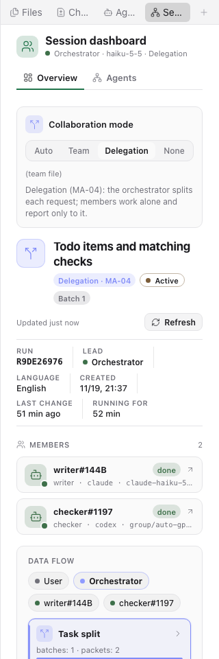
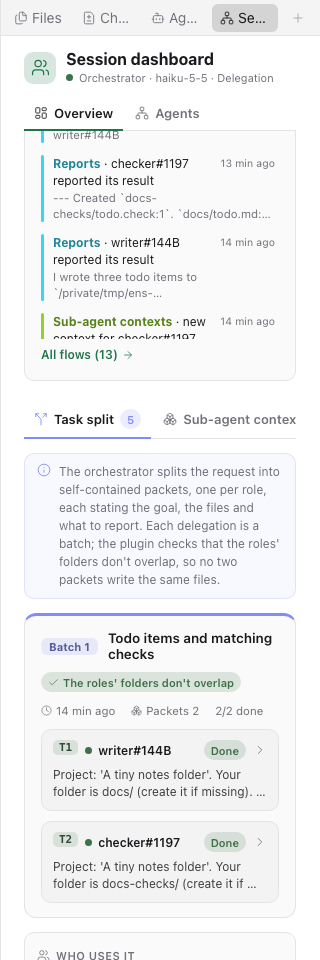

# Ensemble guide

The full manual for Ensemble, the agent-team plugin for [Paseo](https://paseo.sh). The [README](../README.md) has the overview, screenshots and install steps; [OVERVIEW.md](../OVERVIEW.md) is the short behaviour reference.



## Concepts

| Term | Meaning |
| --- | --- |
| **Project** | A repository registered in Paseo. A team belongs to one project. |
| **Workspace** | A Paseo workspace in that project. All of a team's roles work in the orchestrator's workspace. |
| **Role** | A name plus the provider, model, folders and instructions for one role, for example `design → codex/gpt-6.1-sol`. |
| **Orchestrator** | The agent that reads the team and delegates each part of a request to the role that owns it. |
| **Team definition** | One file per team in `.agents/teams/` at the project root, or the single file `.agents/team.json`. It is the source of truth for the team and is meant to be committed. |

The team lives in the repository rather than in plugin settings, so it is shared through git and readable by agents. Workspaces are matched by title, not by ID, so the same file works on any machine.

A project can run several teams, one per workspace. A team belongs to the workspace its orchestrator runs in, and the **Agent team** tab of a workspace (the team editor) shows that workspace's team. Teams never share a workspace: a team's orchestrator and roles all run in one workspace that belongs to that team only.

## Requirements

- Paseo 0.16.0 or later, with **Settings → Plugins → Enable plugins** turned on.
- At least one provider ready on the host. Check with `paseo provider ls` and `paseo provider models <provider>`.
- **Paseo tools turned on for agents**: Settings → your host → **Orchestration → Enable Paseo tools** (`daemon.mcp.injectIntoAgents`, off by default; `paseo daemon config set daemon.mcp.injectIntoAgents true`). The plugin serves its team tools next to Paseo's own, so the orchestrator and members only get them with this on. The team editor warns, and Start a session, Apply again and Reset session refuse, while it is off. A provider-level Paseo tools policy that leaves out the `team_*` tools has the same effect for that provider.

## Install

From a local checkout:

```bash
git clone https://github.com/DueGin/paseo-ensemble.git
cd paseo-ensemble
npm install
paseo plugin install "$(pwd)"
paseo plugin ls   # paseo-ensemble should be "running"
```

Or paste the absolute path of the checkout into **Settings → Plugins → Plugin source** in Paseo. Reload the Paseo window afterwards so the app picks up the plugin's UI.

## Usage

### 1. Create a team

Open a workspace in the project you want a team for, then:

1. Open the **Agent team** tab of the workspace (the team editor), the **Teams** tab of the Agent team sidebar, or run **Agent teams** from the Command Center. A team created from a workspace runs its orchestrator in that workspace.

   Without an open workspace, for example on the New workspace screen, use **Agent teams** in the sidebar instead. It lists every project with its teams (orchestrator workspace, goal, role count) and any team-file errors. **Open team** opens that team's editor in its orchestrator workspace; when that workspace no longer exists, the row shows **Reconnect** in its place. **New team** on a project continues with step 2. The planner starts in an existing workspace of that project, or in a new `Team planner` workspace if it has none. After **Start a session** you are taken to the orchestrator's workspace.
2. Describe the goal, for example `2D platformer game`, and press **Propose a team**, or leave the goal empty and press **Plan from the project**: the planner then reads the project (README and docs, CLAUDE.md or AGENTS.md, manifests, the source layout, tests, TODOs), writes the goal itself and plans the team from it. Either way the planner proposes fixed roles, candidate members (see Preset teams below), or both, and a collaboration mode, using only the providers and models that are ready on this host. It takes a minute or two. You can leave the screen meanwhile: when you come back, the newest proposal for this workspace (or project) is picked up again, still running or ready to review. Proposing again or pressing **Cancel** in the review archives the earlier planner, so a cancelled proposal does not return.
3. Review the proposal. Every role runs in the orchestrator's workspace. You can rename roles, pick the provider and the model from searchable lists (press a field, type to filter, pick an item), set the folders each role owns, edit instructions, and add or remove roles. A role's folders field is hidden behind **Set folders** until you set folders, and is shown when the role already has folders. To have AI change the team, type a request under the role list, for example "add a docs role and move ui to another model", and press **Edit team with AI**. The request is treated as an edit of the existing team: a request that names a role, or whose work fits one, changes that role (its instructions, folders, provider or model, or name) instead of adding a role. A new role is added only when you ask for one or when no role fits, and a role is removed only when you ask or when it is merged into another. A planner agent titled `Team editor` reads the repository and proposes a revised team from the current draft. When it finishes, the revised team is applied to the draft straight away, and a notice lists the roles added, removed and changed (with the fields that changed), whether the orchestrator's provider or model changed, whether the goal changed, and any problems. **Undo** and **Redo** next to the button step back and forward through AI edits, one step per edit, and cancelling the review clears that history. The orchestrator's workspace never changes, and nothing is written to the team file until you press **Save** or **Start a session**. The `Team editor` agent is archived as soon as its revised team is read, so its tab closes. If it failed or stopped on a permission prompt, it stays open for you to look at and is archived with the other planners when a session starts. A blank role added in the editor is named `role`, or `role#XXXX` (4 random uppercase hex characters) when that name is taken. Problems such as an unknown model are shown in red at their field, and the header's check counts them (press it for the list; press an item to go to its field). **Start a session** stays disabled until they are fixed.

   Each role card shows the start of its instructions with **Edit instructions**, which opens a dialog with the full text. You can type in the dialog directly, or type an optional request and press **Improve with AI**: an instructions planner reads the repository and proposes a rewrite, shown in the dialog with **Apply suggestion** and **Discard**. **Save** in the dialog only updates the draft; the team's file is written by the editor's **Save** or **Start a session**. The instructions planner is archived with the others when a session starts, and until then it stays in the project.
4. Press **Save** to write the team file and nothing else, or **Start a session**: it asks for an optional first request for the lead (empty: the lead introduces the team and waits), the mode and the agent language for this session, and where the lead runs (this workspace, the workspace named in the team, or a new workspace with a copy of the team). It then writes the file and starts the lead.

To skip the planner, press **Start with an empty team** and fill in the roles yourself.

Starting a session does four things in order. It writes the team's file (and, when needed, the allow rules described under Limitations), makes sure the orchestrator's workspace exists, starts the orchestrator, and cleans up the planners. A new team is written to `.agents/teams/<orchestrator workspace>.json`; a team that already has a file, including `.agents/team.json`, keeps it. An existing workspace with the same title is reused, and a missing one is created in the project. Applying again tells the team's running orchestrator to re-read the team instead of starting a second one; none is archived. Starting refuses a team that uses a workspace another team of the project already uses.

Cleanup archives every planner agent left in the project, including ones from proposals you cancelled. A `Team planner` workspace is archived too, but only when the team doesn't use it and no other agent is left in it. If cleanup fails, the session still starts and the failure is shown as a warning.



### Or start from a new chat

Paseo's own new-agent draft, and the New workspace screen, have a **Team** control next to the model picker. Pick this workspace's team or a preset, write the request and send it: the new agent becomes the team's lead and starts on the request. A preset also picks its lead model and is written as the workspace's team file (a workspace that already runs another team refuses it); **Team mode** sets the session's mode. Picking this workspace's team where there is none refuses to start the agent and says to pick a preset or set up a team first. Such a lead gets its standing instructions with its first `team_status`.

### 2. Work through the orchestrator

After **Start a session**, find the agent titled **Orchestrator** in the orchestrator workspace (the sidebar's **Session** tab opens its chat), and talk to it in plain language:

> Redesign the title screen and add jump and coin sounds. Report back when both are done.

The orchestrator works in the team's collaboration mode. It starts and messages members only through the plugin's team tools, so each member runs on exactly its role's provider, model and mode, is titled `<role>#<id>` (for example `ui#ADB2`), is labelled `role=<role>`, and is started as a child of the orchestrator, so it sits under it on the dashboard. An idle member of the role on the same provider and model is continued instead of starting another.

**Members work unattended.** A member starts in its provider's unattended mode: the mode marked unattended, otherwise the one Paseo marks dangerous, otherwise a mode named like bypass, full access or yolo (for example `bypassPermissions` for Claude and `full-access` for Codex); a provider with none of these uses the orchestrator's mode. Any tool permission prompt a member still raises is allowed by the plugin, so delegated work never waits for you. Plan, question and mode prompts are left to you. The orchestrator keeps its reviewed auto mode (see Limitations).

**Delegation cards.** When the orchestrator gives a member work, its chat shows a **Handed off to agent** card (**Given more work** when an idle member is continued), with the member's provider and the task. When the member's turn ends with a result, an **Update from worker** card follows with the result, marked **Failed** or **Stopped** when the turn did not complete. Press a card to expand it, the member's name to open its chat, and the network icon to open the session dashboard.



#### Choosing the mode

| Mode | Pattern | How a request runs |
| --- | --- | --- |
| **Delegation** | MA-04 | The orchestrator splits the request into self-contained tasks (`team_delegate`). Members work alone and see only their own task; the orchestrator collects the results (`team_wait`) and reports. |
| **Team** | MA-08 | The orchestrator, as liaison, first works out the requirement with you, records a brief (`team_brief`) and shows it to you. Only after you confirm it (`team_kickoff`) do members start, together, on a shared board. After a work round the plugin runs a review round, then the orchestrator integrates and checks the acceptance criteria. |
| **Auto** | | The orchestrator picks one of the two for each request and says why. |

- **In advance**: set the mode in the team editor; it is saved as `mode` in the team file. A planner proposing a team picks it from the goal, usually `auto`.
- **Per session**: the orchestrator's chat has a **Mode** pill next to the composer, and the session dashboard has a mode switch. The switch applies to that orchestrator session only and is announced to it; a run in progress keeps its mode. Picking the file's mode again clears it.
- **Per request**: in Auto, name a mode in your request.
- The plugin enforces it: `team_delegate` is refused in Team mode and `team_kickoff` in Delegation mode.

#### Team mode in detail



Team mode follows the "team" shape of multi-agent systems (lead + shared task board + mailbox, as in Claude Code Agent Teams, Hermes Kanban or Paperclip), with the components below.

| Component | How it works here |
| --- | --- |
| Lead and members | The orchestrator leads; members run the team's roles (or roles it formed from candidates) as its child agents. |
| Requirement intake | The orchestrator asks questions, then records the brief and the task plan with `team_brief`. `team_kickoff` starts only on a quote from a message you sent after the brief was recorded, so a request, or anything said before the brief, can't start a run. No member starts and no file changes during intake. |
| Shared task board | Tasks with an id (`T1`…), details, a role (or anyone), dependencies, files, a state (todo, doing, done, dropped) and an owner. A task that waits for others can't be claimed; it unlocks when they are done. Claiming is atomic, and claiming a task also claims its files. Members claim, finish, release and add tasks (`team_task`); the orchestrator adds, edits, reassigns, reopens and drops them (`team_tasks`). |
| Self-scheduling | A member takes the next ready task for its role, then one for anyone. When a member is idle, holds no task, and a task is ready for it whose files nobody else holds, the plugin claims it for the member and wakes it (at most six times per member per round; a task isn't handed straight back to the member that returned it). A role with ready work but no member in the run gets one started (up to eight members per run). New work after the orchestrator was told the run finished opens another round, so it hears back again. |
| Mailbox | Posts on the board can be addressed to roles, a member's title (such as `api#1A2B`), `lead` or `all`. They reach a working recipient with its next team tool result, without interrupting it, and wake an idle one with all its unread mail (at most three wake-ups per member per round). Messages to the orchestrator also come back in its tool results and end its `team_wait`. A member that loses a task to the orchestrator's reassign or drop gets a direct message to stop. |
| Plan approval (optional) | With `planApproval`, a member submits a plan for each task it claims and waits; the orchestrator approves it or sends it back with feedback (`team_tasks`, review). The verdict reaches the owner with its next tool result, or wakes it when idle; until then the task and its files stay with the owner. A task can't be finished without an approved plan, and the round doesn't end while plans or verdicts wait. |
| Quality gate | In the review round, members check each other's done tasks against the brief and send back what misses it with a reason (`team_task`, reject); the orchestrator can do the same when it checks the acceptance criteria. A sent-back task goes back to its role with the reason. |
| File claims | `team_board_claim` for paths outside a member's tasks; overlapping claims of working members are refused. |
| Replacing members | Moving a formed role to another candidate retires its member in the run; its open tasks go to a new member. An archived member is retired too. |
| Closing | `team_close` ends the run, releases claims and can archive the members. A new run also closes the previous one. A run whose orchestrator is archived and whose workspace no longer exists is closed by the plugin, so it is not retried. |
| Observability | The session dashboard shows the tree, the task board by state (with dependencies, plans waiting and sent-back tasks), the brief, the latest posts and the claims. |

All members share the orchestrator's checkout; there is no per-member worktree. Runs are stored in `.agents/runs/<run>.json` (kept out of git).

```
Delegation: request → orchestrator splits it → members work alone → orchestrator sums up
Team:       request → intake with you → confirmed brief + task plan → task board (claim, dispatch, mail) → review round → orchestrator checks and integrates
```

#### Global team presets

The **Agent teams** screen (sidebar) starts with **Team presets**: a library shared by every project on the host. A preset has a name, a description, a collaboration mode (**Auto**, **Team** or **Delegation**), the orchestrator's provider and model, and a pool of candidate members. Create, edit and delete presets there, or save an existing team as a preset with **Save as preset** in the team editor (its fixed roles become candidates, noted with their instructions). **Rename** changes a preset's name in place. **Copy to project** writes a preset into a project as a team file (`.agents/teams/<preset>.json`, asking which project when there are several); it has no workspace yet, so press **Reconnect** on its row to give it one. The sidebar's **Teams** tab has the same Copy to project and Rename.

To use one, press **New task from preset** on any project's card: pick the preset, adjust the mode for this task if needed, describe the request, and pick a new workspace (named after the request unless you name it) or an existing workspace that has no team. The plugin writes the team for that workspace (a copy of the preset, recording which preset it came from, so later edits of the preset don't change it), starts the orchestrator with your request as its first message, and opens it. In the team editor, **From a preset** fills the draft from a preset instead, for review before **Save** or **Start a session**. The sidebar's **Start** tab starts a lead from a preset straight away, in a new workspace when this one already runs a team.

Presets are stored in the plugin's host settings. They survive plugin reloads, updates and daemon restarts, and every client of the host sees the same list; removing the plugin installation deletes them.

#### Candidate members

A team can have **candidate members** instead of, or next to, fixed roles: a pool of models that are **not roles**. Each candidate has a provider and model, an optional identifier (left empty, it is taken from the model, such as `haiku-5-5`; it is only the handle the orchestrator uses to pick it), and a **description**: what it is good at and suited for, its cost or speed, and the work it must not be given, for example:

```
Good at / suited for: architecture, hard bugs, reviewing designs
Cost or speed: slow and expensive
Do not give it: routine edits, writing tests
```

The orchestrator splits the work and gives each piece to the candidate whose description fits it. What a description rules out is a hard rule in its instructions: it never gives that candidate such work, also not inside a larger task, and does the work itself or tells you when no candidate fits. It can give work straight to a candidate by its identifier (in `team_delegate` or a team task); the member then runs on that model with the description as its notes. For a narrower job on one model (its own instructions or folders, or two jobs on the same model), it can form a session role with `team_role`. Either way it can only use the candidates' providers and models; the plugin refuses anything else. The descriptions are instructions to the orchestrator, not something the plugin can check against the content of a task.

### 3. Change the team

Open the team editor (the **Agent team** tab) in the team's orchestrator workspace, change the team and press **Save**, then **Apply again** so a running orchestrator re-reads it. Or edit the team's file directly and press **Apply again**. The editor shows the file's path, whether the editor has changes the file doesn't have yet, and flags any provider or model the host can't run. If you rename the orchestrator's workspace in Paseo, the team shows as "workspace not found" on the **Agent teams** screen; press **Reconnect** on its row and pick the renamed workspace. That rewrites `orchestrator.workspace` in the team's file (and in an old `.agents/team.json` for the same workspace) to the workspace's new title. The file name and agents are not changed, and Reconnect refuses a workspace another team uses. If the orchestrator's workspace is gone rather than renamed, the Reconnect panel also offers **Start in a new workspace**, which runs the team like **Start a session** with its saved file: it finds or creates the workspace named in the team file, starts the orchestrator and opens that workspace. The panel lists only the project's workspaces that no other team uses, since one workspace runs one team. When none is free, the panel says so and offers only that button and Cancel. To reset the orchestrator session with the same team, press **Reset session** next to **Apply again** (see Limitations).

To delete a team, press **Delete** on its row in the **Agent teams** screen and confirm. The delete archives the team's orchestrator, the role sessions labelled with its roles in its workspace (role names match case-insensitively), and any planner still proposing for its workspace, so a pending proposal does not come back. Agents in a workspace another team uses are left alone. No workspace is archived: Paseo workspaces carry no labels, so the plugin cannot tell one it created from one you made, and empty workspaces stay for you to archive. Only after every agent is archived are the team's file and any old `.agents/team.json` for the same orchestrator workspace deleted. If an agent can't be archived, no file is deleted and you can retry from the same row. If a file can't be deleted, a separate message says so. A file that is committed to git shows up as a deletion to commit.

```
Delete → archive the team's agents → delete the team's files
              ↓ an agent can't be archived
         no file is deleted; retry from the same row
                                       ↓ a file can't be deleted
                          a separate message says so
```

### 4. Watch the agents

The **Agent team sidebar** keeps the team at hand while you work. Open it from the right sidebar's **+** menu (**Agent team**) or with **Open the Ensemble side panel** in the Command Center. It has three tabs:

- **Session**: the workspace's orchestrator with its state, the collaboration mode switch, the members (press one to open its chat) and the latest run's data flow. Each part opens the session dashboard. With more than one team session in the workspace, pick one.
- **Start**: start an orchestrator from this workspace's team or a preset, with an optional request, the mode and the agent language, here or in a new workspace.
- **Teams**: the project's teams (press one to open its editor), **Create a team**, and the presets with Copy to project and Rename.

<p>



</p>

The **session dashboard** shows one conversation. Its **Agents** tab shows the session's agents as a tree in which an agent started by another agent sits under it.

- **Session dashboard** (**会话仪表盘** in Chinese): one conversation only. Open it with **Open the session dashboard** at the bottom of the sidebar's **Session** tab, from the **Dashboard** pill next to the composer of any collaborating agent, from the Command Center (**Session dashboard: this session**), or with `/dashboard` in that chat. It opens in the right sidebar and shows the session the agent belongs to: the top agent of its parent chain (usually the orchestrator) and every agent below it, including members started in other workspaces, and nothing else from the project. Below the tree it shows the session's latest run: a mode switch, the roles the orchestrator formed, and its **data flow** (数据流), a diagram of who takes part (you, the orchestrator, the members, the plugin) and the parts of the collaboration mode on the right (team mode: the brief, the shared task board, plan approval, the team board, file claims; delegation mode, following MA-04's "split → isolated sub-agents → summary": the task split, the sub-agents' contexts, the reports and the summary), with lines for the latest flows between them, a moving dot for anything in the last 30 seconds and each part's newest event. In a narrow sidebar the participants stack above the parts instead. Under it, the latest flows are listed. Press a part, or one of those flows, to open its page: what the part is, its full content (every task with its plan, result, feedback and history; every post; the brief before and after confirmation; the plan of each task; the paths each member holds; in delegation mode each batch's packets with why delegation and the folder-overlap check, what each sub-agent's context holds and whether it was new or reused, each report and how long it took, and the orchestrator's summary of each batch with the split-to-summary time and the slowest packet), who wrote into it and received from it, and its whole history. The **All flows** page lists every step, filterable by part.

Agents with no parent are roots and stay shown unless they are closed or archived, and roots without children are listed under **Solo agents**. Roles of the team that are not started yet appear under the newest orchestrator of the team's workspace as dimmed **Waiting** cards on a dashed line; a waiting card is replaced by the real card once an agent labelled with that role shows up in the team's workspace. The orchestrator's caption shows the team's mode. Provider sub-agents, such as the sub-agents Claude Code starts with its Agent tool, appear as lighter **Sub-agent** cards under the Paseo agent that spawned them, labelled with their sub-agent type. They can't be opened, since they are not Paseo agents. In **Brief** density they are collapsed into a **+N** badge under their parent that expands on press. With **Show closed** off, a role agent or sub-agent is shown only while it is running or has the **!** badge, when one of its descendants is, or when it is the newest finished one of its type (role, or sub-agent type) under the same parent. Older finished ones, and the agents under them, are hidden. An agent whose parent is not shown becomes a root and follows the same rule. With **Show closed** on, every agent is shown.

Use the **Density** toggle in the Agents tab's header to choose one of three levels. **Normal** is the default.

- **Brief**: a one-line pill with the provider logo, the role or title, a short model name and the status.
- **Normal**: a two-line card, 150px wide (140px in a narrow panel), with the logo, title and status, then `model · mode`.
- **Detailed**: the full card with caption, model, effort and mode chips, described below.

The choice is remembered per tab, like **Show closed**. Glow, arrival flash, signal dots and dashes are scaled to each level's node size.

With **Show closed** on, a closed or archived agent card, or a finished sub-agent card, shows a small × that hides it, together with the agents under it, from that dashboard tab. Cards that are running, need attention (**!**), or have a running agent under them have no ×. The header then shows **Restore hidden (N)**, which brings them all back. When there are closed agents to hide, the header also shows **Hide closed (N)** at the right, which hides every card that has a × at once. Hiding does not delete or archive anything in Paseo. The hidden list is remembered per dashboard tab, like **Show closed**, so the dashboard in a workspace tab and the one in the right sidebar keep separate lists. A Paseo agent whose session stopped on an error, such as a provider reporting insufficient funds, also shows a small **Archive** button. Pressing it archives that agent, so its tab closes and its card leaves the dashboard; it shows again only with **Show closed**. Cards waiting on a permission prompt, running cards, cards with a running agent under them, and provider sub-agents have no **Archive** button.

In **Detailed** density, each card shows the provider logo, the role or caption, the title, and the model, effort (thinking option) and permission mode chips. When an agent has no effort set, its effort chip shows the model's default effort from the provider, dimmed. The badge is **!** when the agent is waiting for a permission or has failed, an amber pulsing dot while it runs, and ✓ when it has finished. Lines to running agents turn into animated red dashes with moving signal dots. An agent that is not running itself but has a running agent below it, such as an orchestrator waiting on its role agents, gets an amber border without the glow. Press a card to open that agent. Closed and archived agents are hidden unless **Show closed** is on.

### 5. Run another team in another workspace

Open the **Agent team** tab in a workspace that has no team yet and create one as in step 1. Its orchestrator runs in that workspace, and the team is written to its own file in `.agents/teams/`. Each team's orchestrator reads only its own file, so the teams don't change each other.
```
Workspace A editor → team A (.agents/teams/a.json) → orchestrator in A
Workspace B editor → team B (.agents/teams/b.json) → orchestrator in B
```

## Team definition format

`.agents/teams/<orchestrator workspace>.json`, or `.agents/team.json`:

```json
{
  "version": 1,
  "goal": "2D platformer game",
  "mode": "auto",
  "orchestrator": { "workspace": "orchestrator", "provider": "claude", "model": "claude-opus-5-5" },
  "roles": [
    {
      "name": "design",
      "provider": "codex",
      "model": "gpt-6.1-sol",
      "folders": ["src/ui", "assets/images"],
      "instructions": "Owns the UI and all visual assets."
    },
    {
      "name": "sound",
      "provider": "antigravity",
      "model": "gemini-4-argon-high",
      "folders": ["assets/audio"],
      "instructions": "Sound effects and music."
    }
  ],
  "candidates": [
    { "provider": "claude", "model": "claude-opus-5-5", "notes": "Good at: architecture, hard bugs\nDo not give it: routine edits" },
    { "name": "fast", "provider": "codex", "model": "gpt-6.1-sol", "notes": "Good at: quick implementation\nDo not give it: design decisions" }
  ]
}
```

| Field | Required | Notes |
| --- | --- | --- |
| `version` | yes | Always `1`. |
| `goal` | no | What the team is for. Shown to the orchestrator. |
| `mode` | no | `auto`, `team` or `delegation`. A file without it runs in `delegation`, as before modes existed. |
| `orchestrator.workspace` | yes | Workspace title for the orchestrator. The team belongs to this workspace, and no two teams of a project may use the same one. |
| `orchestrator.provider`, `.model` | yes | Provider ID and model ID, as listed by `paseo provider models <provider>`. |
| `roles[]` | no | Fixed roles. A team needs at least one role or one candidate. |
| `roles[].name` | yes | Unique, case-insensitive. |
| `roles[].provider`, `.model` | yes | Must be ready on the host when you apply. |
| `roles[].folders` | no | Folders the role owns. Empty means no limit. The orchestrator keeps roles inside them and runs overlapping work one after another. |
| `roles[].instructions` | no | Extra guidance for that role. |
| `candidates[]` | no | The preset pool the orchestrator forms roles from during a session. |
| `candidates[].provider`, `.model` | yes | A provider/model ready on the host. |
| `candidates[].name` | no | A unique identifier; taken from the model (`haiku-5-5`) when empty. Not a role. |
| `candidates[].notes` | no | The description: what it is good at and suited for, its cost or speed, and work it must not be given. |
| `preset` | no | `{ id, name }` of the global preset the team was started from. |

## Language

The plugin's UI follows Paseo's app language. English is the default, and English, Korean, Japanese and Simplified Chinese UI text are included. Error messages from the daemon side are in English.

## Limitations

- A role's model applies to members the plugin starts. Agents you start yourself in the team's workspace from Paseo's own UI still use whatever model you pick there.
- The orchestrator and members need the plugin's team tools, which Paseo serves with its own tools. If Paseo tools are turned off for a provider, the orchestrator says so and stops; a member without the board tools reports in its final reply, which the plugin puts on the board.
- A team's file is matched to its workspace by `orchestrator.workspace`. Renaming that workspace in Paseo or in the file detaches the team from it until the two match again. Paseo has no rename event, so after renaming in Paseo, press **Reconnect** on the team's row (or edit `orchestrator.workspace` in the file) to reattach it.
- All roles run in one workspace, so they share one checkout and folder. In team mode, claims stop two members from editing overlapping paths at once, but only for members that claim first; in delegation mode the orchestrator is told to give overlapping work to one role or run it in sequence, and `team_delegate` warns when two roles' folders overlap.
- Paseo doesn't tell a sidebar panel which chat has focus. The session dashboard shows the session it was opened from; open it again from another chat to follow that one.
- The plugin moves runs along from Paseo's turn events. If the plugin is reloaded while members work, the orchestrator's next `team_wait` catches up on members that finished meanwhile. One `team_wait` returns after at most 9 minutes (tool calls are capped at 10); the orchestrator then waits again or answers you, and the plugin tells it when the run has finished.
- Members start in their provider's unattended mode, and the plugin allows their tool permission prompts (see Work through the orchestrator). This lets them run commands and change files without asking; give a team only work you would let an unattended agent do.
- The planner and the orchestrator start in the provider's reviewed auto mode when it has one: Codex's Auto-review (`auto-review`), otherwise an `auto` mode such as Claude's Auto mode (`auto`), otherwise any other mode whose id or label has a word starting with `auto`. Only a provider with none of these uses its unattended mode: the one marked unattended, otherwise the one Paseo marks dangerous, such as Antigravity's Full access. A provider with none of these modes but an Auto Accept feature, such as Cursor, starts them with that feature on instead. Otherwise they use the default mode. A provider without an unattended mode starts its members the same way. The planner is told not to change files but is not technically prevented from doing so.
- When the orchestrator runs on Claude, Start a session, Apply again and Reset session add its team tools (`mcp__paseo__team_status`, `mcp__paseo__team_delegate`, …) to the project's `.claude/settings.local.json`, and the board tools when a role runs on Claude, so Claude's Auto-mode reviewer doesn't deny starting a member in an unattended mode. Remove the rules to undo them. Claude Code ignores that file in git only when Claude Code itself created it, so check that you don't commit it.
- Collaboration runs are stored in `.agents/runs/` in the project, with a `.gitignore` the plugin writes. The newest 50 finished runs are kept.
- Global presets live in the plugin's host settings: removing the plugin installation (for example to switch from a local checkout to a Git install) deletes them. A team started from a preset keeps its own copy in its team file.
- Sending `/clear` in the orchestrator's chat makes Paseo archive that agent and start a new one with no labels, so it loses the team tools and instructions. Use **Reset session** in the team editor instead: after a confirmation it archives the labelled orchestrator and starts a new one with the same team, read from the team file; members are kept.
- A team file written by an older version may still list a workspace for a role. Roles still run in the orchestrator's workspace; starting a session or Apply again removes the old field.
- Paseo's sidebar puts a workspace it hasn't seen yet at the top of its project, so a workspace that Start a session creates appears there. The plugin cannot set the sidebar order.
- Very long workspace or agent lists are read as a single page. On hosts with a lot of workspaces, an existing workspace could be missed and created again, and the session dashboard can miss agents beyond that page. Team delete has the same gap.
- On Paseo hosts without client navigation, the dashboard cards are not pressable.
- Sub-agents started before the dashboard opened are found in the last 200 timeline items of each unarchived agent shown. A sub-agent found that way takes its status from the timeline and can read finished while a background sub-agent is still running.
- Paseo groups plugin rows with the turn's tool calls, so the delegation cards sit inside the turn's tool group (such as "Team delegate and team wait"); expand the group to see them.
- The plugin cannot delete agents; Paseo's plugin API offers only archive. The dashboard's × only hides an agent in that tab.
- In the narrow right sidebar, when the panel is too narrow for the whole tree, the orchestrator card shrinks to its provider icon and model name, and the tree scrolls horizontally.

## Development

```bash
npm install            # .npmrc sets legacy-peer-deps, which works around an npm 10.9 resolver crash
npm run typecheck
npm test               # unit tests
PASEO_E2E=1 npx vitest run tests/daemon.e2e.test.ts   # against the local daemon
PASEO_E2E=1 npx vitest run tests/collab.e2e.test.ts   # both collaboration modes with real agents (PASEO_E2E_MODEL, default claude/claude-haiku-5-5)
paseo plugin reload paseo-ensemble
paseo plugin logs paseo-ensemble
```

The end-to-end test starts real agents (a planner and an orchestrator) in a temporary project under the system temp folder, so it costs tokens. It connects to `ws://127.0.0.1:6767/ws` unless `PASEO_URL` is set.

Layout: `shared/` holds the team schema, collaboration modes (`modes.ts`), run state (`collab.ts`), validation, prompts, RPC contracts and UI text, and is compiled into both sides. `server/` holds the daemon-side RPC handlers (`team.ts`) and the team tools and lifecycle hooks (`collab.ts`). `client/` holds the UI: the design kit (`kit.tsx`) every surface builds from, the team editor (`editor/`), the session report (`report/`), the Agent team sidebar (`side/`), the delegation cards (`Cards.tsx`), the session dashboard, the teams screen and the composer pills. `tests/` holds the Vitest suites.
